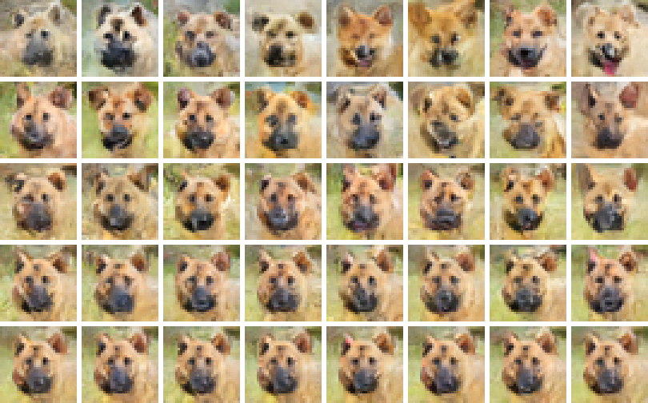
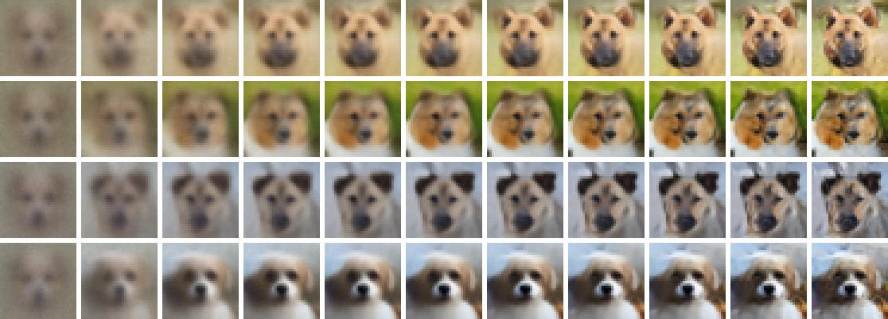
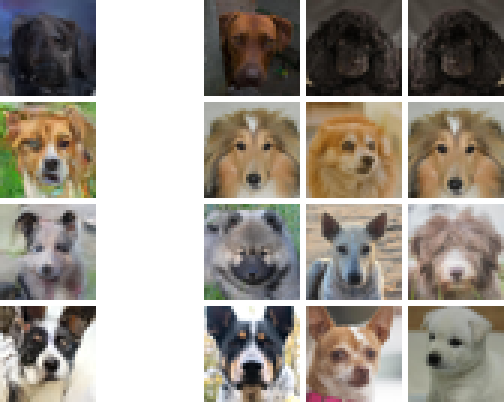
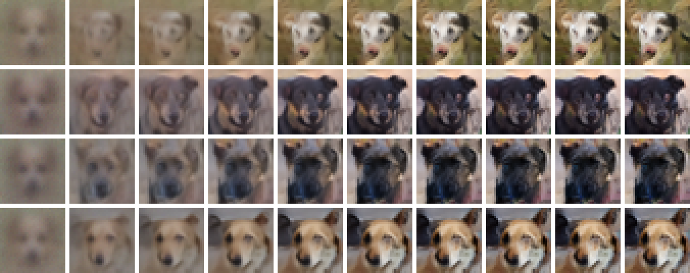

# Noise to Dog

A 3.9M-parameter flow matching model trained from scratch on 4,265 dog photos (AFHQ, 32×32), running in the browser on hand-written WebGPU shaders. Watch noise turn into a dog, stop at any step, and re-roll the rest to see how much of the dog was already decided.

**[Live demo →](https://gabrielmpr.github.io/noise-to-dog/)** The page also has a 2-D version of the same method that trains in a few seconds while you watch: paint a distribution and see the velocity field learn to carry Gaussian noise onto it.

The model is the U-Net from lab 2 of MIT 6.S184 (*Generative AI with Stochastic Differential Equations*), widened to 64 base channels and trained for 30,000 steps on an M2 MacBook (about two hours) to a held-out loss of 0.219. Everything below was measured on that trained model.

## Findings

**1. Color is decided first, then layout, then fur.** Stop an ODE run at time *t*, finish it 8 times with the SDE (fresh noise each time), and measure how much the 8 results still differ at three spatial scales. Overall color and lighting is half decided by *t* = 0.13, layout (where the head, ears and background sit) by 0.26, and fur and edges by 0.48. At *t* = 0.4 the sample still looks mostly like noise, yet 12% of the color variation is left and 58% of the fine detail.



**2. At t = 0 the model's guess is the average dog.** The predicted endpoint *x*<sub>t</sub> + (1 − *t*)·*u* is the model's estimate of E[*z* | *x*<sub>t</sub>]. At *t* = 0 it is 0.046 rms from the mean training photo, over 256 noise images. A typical photo is 0.49 from the mean. That is why a single Euler step outputs a brown blur.



**3. It doesn't copy its training photos.** Searching all training photos and their mirror images, the median distance to the nearest one is 0.38 for 1,000 generated dogs and 0.39 for the 500 AFHQ validation photos the model never saw. The closest generated dog is 0.25 away. 15 of the held-out photos are closer than that.



**4. Ten steps get most of the way.** The sampling paths are close to straight: the start-to-end distance is 97.6% of the length actually travelled (96.0% for the least straight of 256). With 10 Euler steps the image is 0.14 rms from the 500-step image, against 0.67 between two unrelated generated dogs. At 50 steps the difference is 0.03.



## How the measurements work

- **Re-rolls.** 48 ODE runs of 100 Euler steps. At *t* = 0, 0.1, …, 0.9 each run is copied 8 times and finished with Euler–Maruyama, noise σ<sub>t</sub> = √(1 − *t*). The SDE needs the score, which follows from the velocity for this path: score = (*t*·*u* − *x*)/(1 − *t*), so no second network is trained. Each final image is split into an 8×8 block average (color), 2×2 minus 8×8 (layout) and the rest (detail). The reported fraction is the variance across copies divided by its value for copies started at *t* = 0. Copies from the same starting noise keep part of it in common even at *t* = 0: they vary 31% as much as independent samples.
- **Nearest photo.** RMS pixel distance with pixels in [−1, 1], against the 4,265 training photos plus mirrored copies (training used random flips).
- **Steps.** 256 starting noises, each sampled with *N* steps and compared with a 500-step run from the same noise.

## In the browser

`docs/unet.js` runs the U-Net as WGSL compute shaders: 3×3 and 1×1 convolutions (each thread computes 4 pixels × 8 output channels), GroupNorm + SiLU with a workgroup reduction, pooling, and upsample-and-concatenate. Weights ship as 7.7 MB of fp16. Outputs match PyTorch to within 10⁻⁵ (`docs/parity.html` checks this). One step for one image takes about 15 ms on an M2. Without WebGPU, a plain JavaScript version of the same network runs instead.

The 2-D playground (`docs/mlp2d.js`) is a 3-layer MLP with hand-written backpropagation and Adam, trained in a Web Worker.

## Related work

- Lipman et al. 2023, [*Flow Matching for Generative Modeling*](https://arxiv.org/abs/2210.02747), and Liu, Gong & Liu 2023, [*Flow Straight and Fast*](https://arxiv.org/abs/2209.03003): the objective and the straight-line path.
- Albergo, Boffi & Vanden-Eijnden 2023, [*Stochastic Interpolants*](https://arxiv.org/abs/2303.08797), and Song et al. 2021, [*Score-Based Generative Modeling through SDEs*](https://arxiv.org/abs/2011.13456): SDEs with the ODE's marginals.
- Ho, Jain & Abbeel 2020, [*DDPM*](https://arxiv.org/abs/2006.11239), section 4.3: the same re-roll experiment on CelebA-HQ. Finding 1 measures it by spatial scale.
- Dieleman 2024, [*Diffusion is spectral autoregression*](https://sander.ai/2024/09/02/spectral-autoregression.html): why coarse-to-fine happens.
- Carlini et al. 2023, [*Extracting Training Data from Diffusion Models*](https://arxiv.org/abs/2301.13188), and Somepalli et al. 2023, [*Diffusion Art or Digital Forgery?*](https://arxiv.org/abs/2212.03860): memorization, measured with nearest-neighbor search.
- Holderrieth & Erives, [MIT 6.S184](https://diffusion.csail.mit.edu/): the course and lab 2's setup.
- Choi et al. 2020, [*StarGAN v2*](https://arxiv.org/abs/1912.01865): the AFHQ dataset.

## Run it

```bash
pip install torch pillow numpy
# AFHQ: put afhq/train/dog and afhq/val/dog in this folder
python train.py --iters 30000   # ~2 h on an M2 (MPS); writes ckpt.pt and train_log.json
python analyze.py               # ~10 min; writes docs/data.json, docs/img/, docs/train_atlas.jpg
python export_weights.py        # writes docs/model.bin + model.json for the page
cd docs && python -m http.server
```

`ckpt.pt` is checked in, so `analyze.py` and `export_weights.py` run without training.

## Files

| File | What |
| --- | --- |
| `model.py` | The U-Net, plus Euler / Euler–Maruyama sampling and the score and endpoint formulas |
| `train.py` | Flow matching training with EMA weights |
| `analyze.py` | Every number and figure in the findings |
| `export_weights.py` | fp16 weights for the browser, plus a PyTorch reference output for the parity check |
| `docs/unet.js` | The U-Net in WebGPU (and a CPU fallback) |
| `docs/dogs.js` | Sampling, re-rolls and nearest-photo search on the page |
| `docs/mlp2d.js`, `docs/worker2d.js`, `docs/play2d.js` | The 2-D playground |
| `tests/` | Gradient check and settings test for the 2-D network (`node tests/mlp2d_test.mjs`) |
